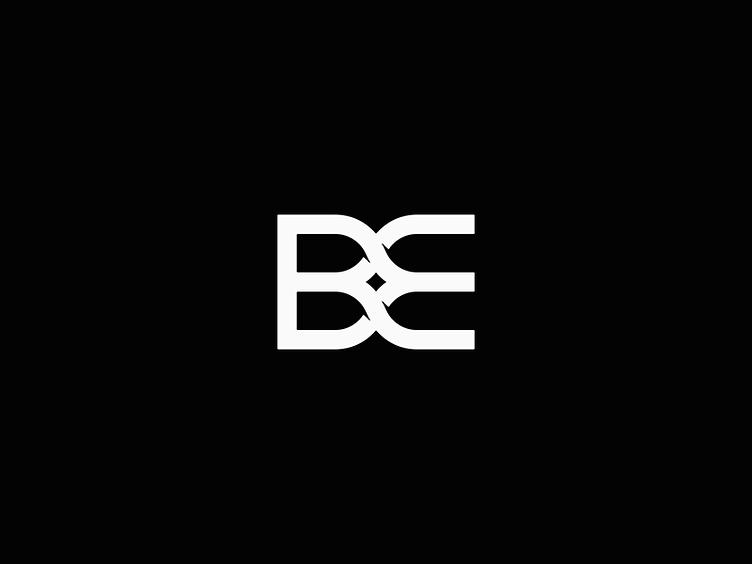

# B-E Motion



An easy, browser-based creative editor that combines a **Canva-style design editor** and a **CapCut-style video editor**. Everything runs locally in the browser, with no server, no sign-up, and nothing to install.

## Run it on your computer (double-click)

1. Download the project: on GitHub click **Code → Download ZIP**, then unzip it.
2. Double-click **`start-windows.bat`** (Windows) or **`start-mac-linux.command`** (Mac/Linux).
3. The first time, it asks you to install [Node.js](https://nodejs.org/) (LTS) if you don't have it, then sets itself up.
4. Your browser opens B-E Motion. Keep the small black window open while you use it.

On a Mac, if it says the file is from an unidentified developer: right-click the file → **Open** → **Open**.

## Install it on your phone or computer

B-E Motion is a **Progressive Web App**: open it in a browser once and install it like a normal app.
It gets its own icon and window and works offline.

| Device | How to install |
| --- | --- |
| **Android** (Chrome) | Tap **Install app** on the home screen, or ⋮ menu → **Install app** |
| **iPhone / iPad** (Safari) | Tap **Share** → **Add to Home Screen** |
| **Windows / Mac / Chromebook / Linux** (Chrome or Edge) | Click **Install app**, or the install icon at the right of the address bar |

Long-press (or right-click) the installed icon for **New video** / **New design** shortcuts.

### Put it online (GitHub Pages)

1. In the repository: **Settings → Pages → Source: GitHub Actions**.
2. Push to the default branch (or run the **Deploy to GitHub Pages** workflow by hand from the **Actions** tab).
3. The app is published at `https://<your-user>.github.io/<repo-name>/`.

**It works with either GitHub Pages setting.** A ready-built copy of the app is kept in the `app/` folder: if Pages is set to "Deploy from a branch", the link opens the source page, which forwards to `app/` automatically. After changing the code, refresh that copy with `npm run build:pages` and commit the `app/` folder. (Setting *Source → GitHub Actions* is still the cleanest option: then every push is built and published automatically.)

### Android APK / Play Store and Windows store packages

Once the site is online, go to [PWABuilder](https://www.pwabuilder.com), enter the site address, and download
an Android package (APK for direct install, AAB for the Play Store) or a Windows package (MSIX).
The app already meets PWABuilder's requirements (manifest, icons, offline service worker).

## Development

```bash
npm install
npm run dev        # open http://localhost:5173
npm test           # unit tests
npm run build      # production build in dist/
npm run preview    # serve the production build on http://localhost:4173
npm run test:e2e   # full browser test against the preview (needs `npx playwright install chromium` once)
npm run test:e2e:pro  # browser test for the pro tools (green screen, keyframes, export…)
npm run test:e2e:next # browser test for MP4, motion tracking, AI tools, tour, templates, design upgrades
npm run test:e2e:more # browser test for fast export, beats, speed curves and the newest tools
npm run test:e2e:unique # browser test for pre-flight check, recipes, post kit, history, sharing
```

## Features

### ✨ Look & feel
- **Editor look setting** (🎨 palette button in either editor): one-click templates styled after popular editing apps — B-E Motion, CapCut style, Premiere Pro style, DaVinci Resolve style, Final Cut style and a light Canva style. Then fine-tune: library panel left or right, small/medium/large timeline, rounded or square corners, roomy or compact spacing, and any highlight colour. Saved on your device and used in both editors. (The templates only borrow a colour scheme and layout feel; B-E Motion isn't affiliated with those apps.)
- Clean dark interface with an icon set, gradient accents, and smooth hover/focus states
- Tidy top bar: every export option lives in one **Download** menu
- Works on phones: panels stack, and tapping the open tab again folds the side panel away

### 🧭 Guided tour
- First-time visitors get a short tour of each editor: it highlights each part and explains it. Replay it any time with the **?** button (keyboard shortcuts moved to the ⌨ button)

### 📁 My projects
- Every design and video is saved automatically in your browser (IndexedDB) and listed on the home screen with a preview
- Open, search and delete projects; video media files are stored with the project

### ✨ Auto edit with AI
- **Raw clips in, finished video out.** Start from **Auto edit with AI** on the home screen, **✨ Auto edit my clips** in the Media tab, or the AI tab
- It **watches every clip** (sharpness, light, movement, sound, speech and shot changes) and keeps the best moments. It never uses blurry or dark parts and never cuts across a shot change
- It **finds the beat** of your song (tempo and beat times) and cuts on it
- **Seven styles**: Hype / TikTok (best shot first, punch zooms on the beat), Cinematic (long shots, fades, film look, widescreen bars), Vlog and Talking / tutorial (keeps what you say and cuts the pauses, optional captions), Travel montage (golden colours, slides with whooshes, location title), Product promo (sharpest shots, sparkles, call to action), and **Long-form** for YouTube videos, podcasts, lectures and interviews
- **Long-form edit** handles footage up to hours long: it keeps every word, trims the dead air, opens with a **“coming up” teaser** (the liveliest moment), adds **chapter cards** at the natural breaks (named from what is said), and plays quiet music that **drops under speech**
- **Smart reframe** fills a new shape (9:16, 1:1…) and pans to follow the action instead of adding blurred bars
- Or **describe it**: “a 30 second energetic travel video for TikTok with warm colours called ‘Lisbon’”. It reads the style, length, shape, colours, pace, title, captions and music from the sentence
- Shows **why it made each cut**, **Try another** gives a different take, and **Undo** takes it all back. The result is an ordinary timeline you can keep editing
- Runs entirely on your device

### 🤖 More AI tools (AI tab)
- **Edit by transcript**: get a transcript of everything said, search it, tap a time to jump there, and cut a line (or several) to cut the video. Works in the original footage's time, so it stays right after trims and moves
- **Remove filler words** (um, uh, erm… and, if you tick it, “like”, “you know”) in one click
- **Make captions from the transcript** (only what is left after your cuts)
- **Smart reframe** the whole project to 9:16, 1:1 or 4:5, following the action
- **Auto-duck**: lowers the music wherever someone talks, with smooth ramps

### 🛫 Pre-flight check (only in B-E Motion)
- Press **Check** (top bar, or from Export) before posting. It watches your video and tells you whether it will work:
  - **Hook score** (0–100) for the first 3 seconds: movement, a title on screen, sound, pace and the first frame, each with tips and one-click fixes
  - **Safe zones** for TikTok, Instagram Reels, YouTube Shorts and YouTube: finds text hidden under the app's buttons and captions, moves it clear in one click, and can show the zones on the player
  - **Accessibility & safety**: flashing that can trigger seizures (WCAG's three-flashes rule), captions too fast to read, text too small or low-contrast, and missing captions
- Everything runs on your device

### 🧪 Edit recipes
- Press **Recipes**, tick what to keep: video shape, intro titles & sounds, outro, caption style, colour look, music, effects, transitions, watermark. Save it with a name
- On your next video, press **Apply** and it is all done in one step (one Undo takes it back). The outro stays the same distance from the end, music is trimmed to fit, captions take the saved style
- Recipes keep their own copy of music and logos, so they still work after the original project is deleted

### 📦 Post kit
- Press **Post kit** when the video is done. It finds the video's three best-looking frames (sharp, colourful, well lit, without your text on top) and makes a **YouTube thumbnail**, an **Instagram post** and a **story / Reel cover** with your title and handle
- Download each as PNG, or press **Edit** to finish it in the design editor
- Also writes a **caption with hashtags** (from your titles and captions) and **YouTube chapters** that follow YouTube's rules (start at 0:00, at least three, 10 s or longer)

### 🕰️ Visual history
- Press the **History** button (next to Undo/Redo) to see every step of this session as a picture with a name ("Added text “Hello”", "Trimmed the clip beach.mp4"…)
- Pick any step to compare it **side by side** with now at any moment of the video, with a list of what changed since. **Go back to this** jumps there, and Redo still brings you forward again
- **Save a version** by name (up to 20). Saved versions stay with the project after you close it, and can be restored at any time

### 🔗 Share & connect (no server, no account)
- **Send from your phone**: press **Share → Send from your phone**, scan the QR code with your phone, then hold the phone's code up to the computer's camera (or paste it). Videos and photos go **straight from the phone to the computer**, with no upload and no cable
- **Edit together, live**: share the invitation link with another computer or phone. They get the whole project with its media, and every change shows on both screens. The badge at the top shows when you are live
- **Project file**: **Download project file** saves the whole project with its media as one `.bemotion` file. Open it on any device with **Open a project file** on the home screen
- Devices connect directly with WebRTC. The codes are only swapped by QR code or copy-paste. It works best with both devices on the same Wi-Fi (some strict networks block direct connections)

### 🎨 Design editor (Canva-style)
- **Same CapCut-style workspace as the video editor**: library tabs on the left, the canvas in the middle with undo, Present and zoom underneath, details on the right, and the pages along the bottom like a timeline
- Canvas sizes for Instagram post/story, YouTube thumbnail, presentation, Facebook cover, A4 poster
- **Multiple pages** (great for presentations and carousels): add, duplicate, reorder and delete pages from the page strip
- **Present mode**: full-screen slideshow with arrow-key navigation
- **Animations**: per-element entrances (fade, rise, pop, slide, wipe) or "Animate this page"; download the design as an **animated video**
- **Keyframes** for any element: scrub *Time on page*, press ◆ on position, size, angle or opacity, and it moves between them. One-click animations and easing too, the same controls as the video editor. Dragging an animated element moves its whole path
- 15 templates with previews (social, video, print, business), filterable by category. New ones: podcast cover, recipe story, fitness class, real estate, webinar banner, restaurant menu, thank-you card and an animated launch slide
- **Magic resize**: switch canvas size and the layout scales to fit
- Text (heading / subheading / body / outlined / shadow), 10 shapes (rectangle, circle, triangle, star, line, heart, arrow, speech bubble, hexagon, diamond), emoji stickers, and image uploads
- Drag to move, handles to resize, a handle to rotate
- **Multi-select**: drag a box across the canvas, Shift-click, or Ctrl+A, then move, duplicate, delete, lock or copy everything together
- **Align & distribute**: left / center / right / top / middle / bottom (to the page or to each other) and even spacing
- **Right-click menu** with quick actions
- Smart snapping to the canvas center and edges and to other elements (hold **Alt** to disable)
- Double-click text to edit it in place
- Fonts, size, bold/italic, alignment, colors, line height, letter spacing, borders, corner radius, transparency
- Text effects: shadow and outline
- **Brand kit** (Brand tab): save your colours, heading and body fonts and logos once; they show up as swatches, in the font menus and as one-click logos in every design and video. **Use brand fonts on this page** restyles headings and body text in one go
- **Google Fonts**: a searchable font menu with 50+ Google fonts (sans, serif, display, handwriting, mono), each shown in its own style; in both editors
- **Curved text**: bend any text into an arch or a dip with the Curve slider
- **Photo frames**: circle, rounded, heart, star, hexagon, diamond, triangle and speech-bubble frames; add one and upload or click a photo to fill it, or put any photo in a frame
- **Icon library**: 45 line icons with search; change their colour and line thickness
- **Grouping**: select several things and press **Group** (Ctrl+G); clicking any part selects the whole group. Ctrl+Shift+G ungroups
- **Photos tab**: make a picture with AI, or search free stock photos (Openverse) and add one, or drop it straight into a selected frame
- **Background remover** for photos: **Smart (AI)** cuts people out of any background; **Plain background** handles white, green-screen or studio-wall shots with a strength slider. Restore any time
- Photo editing: **crop** (Original, 1:1, 4:5, 3:2, 16:9, 9:16 with zoom and position), flip, filter presets, brightness/contrast/saturation/blur/B&W
- **Photo tools**: exposure, temperature, tint, highlights, shadows, sharpen and vignette, plus one-click looks (Auto enhance, Golden hour, Cool blue, Portrait, Crisp, Moody)
- One-click swatches of colors already used in the design
- Solid or **gradient** backgrounds
- Layers panel, bring forward/back, lock, duplicate
- Undo/redo, copy/paste, paste or drag-and-drop images
- Export PNG/JPG at 0.5×, 1× or 2×, a print-ready multi-page **PDF**, or an animated video; save/open editable `.bee.json` project files
- First-time tips and a keyboard shortcuts panel (press **?**)

### 🎬 Video editor (CapCut-style)

**Pro tools (After Effects-style, made simple)**

- **Keyframes**: press ◆ next to position, size, rotation, opacity (or volume, or a mask) to animate it; diamonds appear on the timeline (click one to jump to it). Easing presets — Smooth, Bounce, Elastic, Snap, Hold — instead of a graph editor. **K** adds a position keyframe; dragging an animated item on the player sets a keyframe
- **One-click animations**: fade, zoom, slide, rise, pop, spin, slow drift; plus **motion blur** and **wiggle** (handheld shake) switches
- **Multiple video tracks** (V2, V3, …): put photos/videos on layers above the main track; drag a layer up or down to change its track
- **Green screen**: one click removes a green or blue background (runs on the graphics card), or click **Pick colour** and then the background on the player; soft-edge and green-glow controls
- **Masks**: circle, rectangle, heart, star, diamond with a soft edge and invert; masks can move and grow with keyframes
- **Crop** (free or 16:9 / 9:16 / 1:1 / 4:5) and **blend modes** (screen, multiply, overlay, add…)
- **Speed ramps** (Montage, Hero, Bullet, Flash in/out) and **play backwards**
- **Colour grading**: three colour wheels (shadows, midtones, highlights) and cinematic **looks** (Teal & orange, Cinematic, Vintage, Noir, Golden hour, Cyberpunk…); **save your own looks** and reuse them with one click
- **Audio**: volume that rises and falls over time (volume keyframes) and **noise reduction** (light / medium / strong)
- **Text**: letter-by-letter animations (typewriter, wave, bounce, glitch, rainbow…), **TikTok-style word-by-word captions**, your **own fonts** (.ttf/.otf/.woff)
- **Titles**: animated name captions (lower thirds), subscribe button, countdown, title reveal, breaking news, location, quote, social handle, chapter — just type your words and pick colours
- **Shapes**: animated boxes, circles, rings, lines, arrows, stars, hearts, bursts, ticks — they draw on, pop, spin or pulse
- **More effects**: glitch, chromatic aberration, blur, light leak, lens flare, and particles (confetti, sparkles, snow, hearts, bubbles, dust) with a speed control
- **✨ Remove background (AI)**: cuts the person out of any video or photo, no green screen needed (Cutout tab). Runs on your device with a small person-matting model (MODNet, downloaded once); video masks are made 15 times a second, smoothed so the edge doesn't flicker, and saved with the project
- **Stabilise** shaky handheld clips (Light, Medium or Locked): it measures the shake, keeps your intended camera move and zooms in just enough to hide the edges
- **Studio sound**: one tap makes a voice clearer and more even (rumble and mud removed, presence added, loudness evened out to a steady level), on clips, layers and audio
- **🎥 Multicam**: filmed with several cameras or phones? Pick them, and they are lined up by their sound. Then press 1, 2, 3… while it plays to cut between them live, or **Auto switch** to show whoever is talking. One camera's sound plays all the way through
- **Record screen** (Media tab): your screen, window or tab with your voice, and your camera in a corner bubble on its own layer. Great for tutorials
- **Graph editor** (Animate tab, both editors): see each animated value as a curve, drag keyframes in time and value, and pick **Custom curve** to shape how a move speeds up and slows down with two handles
- **Free stock media** (Media tab): search openly licensed photos and music & sounds (Openverse, no account needed) and Pexels videos (with your own free Pexels key); one click adds them, and the credit stays in the file's name
- **✨ AI pictures**: describe a picture, pick a style (photo, illustration, 3D, watercolour, anime) and it's made in your video's or design's shape. Needs an OpenAI-compatible API key in AI settings (picture models are too big to run in a browser)
- **Ready to post**: after every export you get the finished video with a ready-made caption and hashtags. On phones, **Share** sends it straight to TikTok, Instagram, YouTube and other apps; on a computer, one click opens TikTok, YouTube, Instagram, Facebook, X or LinkedIn's upload page to drop the file into. (Posting automatically or scheduling posts needs each site's own sign-in and a server, so it isn't built in)
- **🙂 Face tools** (Video tab → Faces, and on layers): **Find faces** follows every face through the clip (MediaPipe face detector, on your device). Then:
  - **Privacy blur**: blur, pixelate or black-box chosen faces (or all), following them as they move
  - **Retouch**: smooth skin, brighten faces and enhance detail, only on faces
  - **Follow a face**: one click adds a 😎 sticker on a face or a name label under it that moves with the person
  - **Smart reframe keeps faces in frame** (AI tab), falling back to following the movement
  - Photos in the design editor get **Retouch faces** and **Blur faces** too
  - There is deliberately no face swapping
- **✒️ Pen tool & shape layers** (Titles tab): draw your own shapes and lines on the player (click for corners, drag for curves, click the first point to close). They **draw themselves on** with After Effects-style **Trim Paths** (animatable start and end), with fill, line thickness and glow
- **Text on a path**: run text along an arch, dip, wave, circle or a line you draw; slide it along or let it **travel along** the path
- **Track mattes** (layer → Cutout → Track matte): show a video or photo layer only through a text or shape (video inside big letters), or cut the text out of it; by shape (alpha) or brightness (luma)
- **Move with the music** (Animate tab, clips, layers and text): Pulse, Bounce, Flicker, Shake or Glow in time with the song on the audio track
- **More effects**: Light rays (god rays), Turbulent warp (heat haze / underwater), Echo trails and Fractal fog
- **📱 Screen replacement** (layer → Cutout): click the four corners of a phone, TV, laptop or sign, press **Track the screen**, and your video or photo stays stuck to it with perspective as the camera moves. Drag the corners to fine-tune. (Motion tracking is now sub-pixel accurate too)
- **📸 Instagram filters**: 30 Instagram-style filters (Clarendon, Juno, Lark, Valencia, X-Pro II, Lo-Fi, Inkwell, Moon…) in the Filters tab, a clip's or layer's Color tab, adjustment layers and on photos in the design editor. Two new adjustments too: **Vintage tone** and **Colour shift**
- **Adobe-style effects library** (Effects tab): Premiere / After Effects effect bins — **Blur & Sharpen** (directional blur, radial zoom blur, sharpen), **Distort** (mirror, kaleidoscope, twirl, spherize, ripple, offset, replicate), **Stylize** (mosaic, posterize, emboss, find edges, cartoon, colour halftone, solarize, strobe light), **Colour** (invert, tint, tritone, threshold, leave colour), **Generate** (four-colour gradient, grid, venetian blinds) and **Time** (posterize time)
- **Filters from the AI prompt**: tell Auto edit "…with the Clarendon filter" (or pick one in its new **Filter** menu) and every clip gets it
- **Phones**: the editors are one smoothly scrolling page — the player stays pinned at the top, the tools and timeline sit right under it, then the details and the library. The library tabs are a bar at the bottom of the screen. Swipe the timeline to scroll it, tap to pick a clip or move the playhead, drag a picked clip or its edges to edit. Every desktop option is there (rows wrap instead of hiding buttons), and videos show in the player on iPhones too
- **Premiere-style trimming** (tool buttons above the timeline, or keys **V** select, **N** roll, **Y** slip, **U** slide): **roll** a cut (one clip longer, the next shorter), **slip** a clip to show earlier or later footage in the same spot, **slide** a clip between its neighbours. The main track already ripples (no gaps)
- **J and L cuts** (clip → Video → Pro edit): hear the next scene before you see it, or keep hearing a clip over the next picture; the sound moves to the audio track and the other clip dips quietly under it
- **✂️ Split at scene changes** (clip → Video → Pro edit): finds the camera cuts inside a long clip and splits it there (scene edit detection)
- **Adjustment layers** (Effects tab): filters and colour grading for every layer under it, for as long as it sits on the timeline; Strength mixes it in
- **Colour scopes** (chart button on the player): live waveform, vectorscope and RGB histogram
- **🎨 Colour match** (clip → Color): make a clip's brightness, contrast, saturation and colour cast match another clip
- **⚡ Fast export**: decodes your videos and draws every frame on its own with the browser's video encoder (WebCodecs), so it is usually several times faster than real time, never drops a frame and keeps going in a background tab. Cancel any time. Older browsers record in real time instead
- **Beat markers**: select a song and press **Find beats**; the beats show on the timeline and clip edges snap to them. **Fit clips to the beat** trims or stretches every clip so each cut lands on a beat. Drop your own **markers** with **M** (double-click one to remove it)
- **Custom speed curve**: besides the speed ramp presets, draw your own curve: drag points up to speed up, down for slow motion
- **Export**: one-click presets for YouTube (1080p, 4K, Shorts), TikTok, Instagram (Reels, post, portrait); resolution up to **4K**, **24–60 fps**, quality; **watermark** (text or your logo); save the current **frame as PNG/JPEG**, or the **soundtrack as WAV**

- **CapCut-style workspace**: library tabs on the left (Media, Audio, Text, Stickers, Effects, Transitions, Filters), player in the middle, details on the right, and a full-width multi-track timeline with track headers to hide or mute each track
- **Sound effects library**: 19 built-in sounds (whoosh, riser, glitch, boom, pop, ding, shutter, coin, applause…) — preview with ▶ and add with ＋ at the playhead
- **Video effects track**: shake, zoom pulse, flash, dreamy glow, vignette, film grain, VHS and cinema bars, with a strength slider
- **Quick tools**: delete left/right of the playhead (**Q** / **W**), split (**S** or **Ctrl+B**), freeze frame, mirror, zoom-to-fit timeline, full-screen player
- **Text styles**: title, subtitle, caption box, highlight, outline, neon and more
- 16:9, 9:16, 1:1 and 4:5 projects
- Import videos, photos and music (button or drag-and-drop)
- Magnetic main track: drag clips to reorder and drag their edges to trim. Photos can be stretched to any length
- Split at the playhead (**S**), duplicate, delete
- **Transitions** between clips: crossfade, dip to black, slide, zoom, wipe (click ⇄ between two clips; "apply to all")
- Speed (0.25×–4×), volume, fade in/out
- **Motion** (Ken Burns): zoom in/out or pan across a clip, great for photo slideshows
- **Picture-in-picture**: put a photo or video on top (⧉ on a media card), drag it on the preview, resize, round the corners
- **Blur background**: fill the empty space around clips that don't match the frame shape (e.g. landscape clips in a vertical video)
- Filter presets (Vivid, Warm, Mono, Fade, Dream) and adjustments: brightness, contrast, saturation, blur, B&W
- Text overlays with styles, background box, and Fade/Pop/Slide-up animations. Drag text on the preview to position it
- Emoji stickers
- **Captions**: type a script and it becomes timed captions, or import/export `.srt` subtitle files (`.vtt` import too)
- **Magnetic snapping**: dragged items snap to the playhead, clip edges and other items (hold **Alt** to turn off)
- Music track with its own trim, volume and **fade in/out** controls and **waveforms**; overlapping audio and text stack into rows
- **Voice-over recording** from the microphone while the video plays
- Undo/redo, keyboard shortcuts (Space, S, Del, ←/→)
- Export to **MP4** (H.264 in Chrome, Edge and Safari) or WebM with mixed audio; choose quality (small / standard / high) and 30 or 60 fps, with a file-size estimate
- **Video templates**: vlog intro, product promo, travel story, YouTube end screen, birthday wishes and quote of the day. Each comes with titles, effects and sound, and opens from Home or the Media tab
- **AI dubbing** (AI tab): says everything in another language in time with the video (transcribe → translate → speak each line), with the original voice kept quietly underneath and optional captions in the new language
- **AI tools** (AI tab): **auto captions from speech**, **translate captions** into 16 languages, **AI voice-overs** from typed text, **remove silences** from talking videos, and **auto Shorts** (picks the loudest, liveliest moments and makes a vertical 9:16 clip). They run **on your device** for free (Whisper and MMS voices through transformers.js, downloaded once and cached; translation uses Chrome's built-in translator). Or open *AI settings* and paste your own OpenAI-compatible API key. The key is stored only in your browser
- **Motion tracking**: select a text, sticker, shape or layer, press *Track motion* (Animate tab) and click the thing to follow on the player. It follows that object through the video and writes position keyframes for you. *Remove tracking* undoes it

## Project layout

```
src/
  lib/       shared helpers (undo/redo history, ids, downloads)
  ui/        shared form controls
  home/      start screen
  design/    design editor: types, pure model (geometry, snapping, layers), canvas renderer, UI
  video/     video editor: types, pure timeline logic, playback/export engine, timeline UI
```

The editing logic lives in pure functions (`design/model.ts`, `video/timeline.ts`). These functions are unit-tested and easy to extend. The UI only calls them.

## Roadmap: features to add next

Easier to use
- [x] First-run tips and a shortcuts panel
- [x] Full interactive onboarding tour
- [x] Multi-select (shift-click / marquee) and align/distribute tools
- [x] Grouping
- [x] Right-click context menus
- [x] Template gallery with thumbnails and categories
- [x] Phone-friendly layout

Design
- [x] Text effects (shadow, outline, letter spacing)
- [x] Google Fonts picker, curved text
- [x] Image filters and flip
- [x] Image crop
- [x] Background remover (plain backgrounds)
- [x] AI background remover for busy backgrounds (people)
- [x] PDF export
- [x] Multiple pages, present mode, animations
- [x] Quick reuse of colors already in the design
- [x] Brand kit (saved colors, fonts, logos)
- [x] Gradient backgrounds
- [x] More shapes and emoji stickers
- [x] Frames and an icon library

Video
- [x] Transitions between clips (crossfade, dip to black, slide, zoom, wipe)
- [x] Picture-in-picture overlay track, plus stickers on video
- [x] Captions from a script and .srt import/export
- [x] Automatic speech-to-text captions, translation and text-to-speech (AI tab)
- [x] Silence removal and auto Shorts
- [x] Long-form auto edit, edit by transcript, filler-word removal, smart reframe, auto-duck
- [x] Motion tracking
- [x] MP4 export
- [x] Motion presets (zoom/pan)
- [x] Full keyframe animation (position/scale/opacity), in both editors
- [x] Audio waveforms and voice-over recording
- [x] Beat markers, user markers and fit-to-beat
- [x] Faster-than-realtime MP4/WebM export (WebCodecs)
- [x] Custom speed curves
- [x] AI background removal for video, stabiliser, studio sound
- [x] Multicam editing, screen recorder, AI dubbing, keyframe graph editor
- [x] Free stock media, AI pictures, share-to-apps after export
- [x] Face tools: privacy blur, retouch, enhance, follow-a-face stickers, face-aware reframe
- [x] Save video projects (media stored in IndexedDB)
- [x] Several saved projects with a project list

Platform
- [ ] Cloud accounts and sharing; real-time collaboration
- [ ] Desktop app (Tauri/Electron) and PWA install
